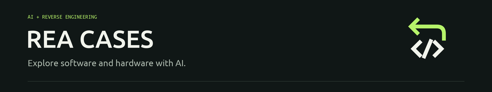

# Awesome REA Cases

[English](README.md) | **简体中文**

### 用 AI 读懂软件与硬件。

精选 **AI 逆向的项目、实验与具体想法**：让旧设备继续工作，重建应用功能，保存游戏，理解隐藏的实现。

# 544 个案例与项目

**最近案例更新／维护：**2026 年 10 月 19 日 20:14 · 北京时间（UTC+8）；数量统计截至此次更新。

**每天更新 6 次** · [完整目录](INDEX.md) · [按分类浏览](#分类浏览)

覆盖 [REA](https://github.com/morluto/rea) 与其他 AI 辅助逆向。REA 通过 CLI / MCP，让编程 Agent 调用本地逆向工具。

*据作者与项目报告整理，未经本合集独立复现；证据与项目状态见各案例详情。*

## 近期精选

**10 个值得读的案例**，优先看实用实现与可追查测试，不以传播口号代替成果。有日期的热度快照供选编参考，不是自动排行榜；下列日期为来源或作者更新日期，不是收录日期。

1. **[Plustek 扫描仪与 ThinkPad 相机](cases/schaller-opticfilm-thinkpad-linux.md)** · `2026-10-16` — 用 Windows 参考行为改善 Linux 驱动；公开测量也保留低光与曝光缺陷。`进行中`
2. **[NIST 曲线种子从哪来](cases/nist-ecdsa-origin-claude-report.md)** · `2026-10-16` — Anthropic 报告 Claude 追到 **lrand48 与时间戳**，公开代码，也保留未解问题。**不是破解 ECDSA**，本合集未独立复算。`研究报告`
3. **[LG UltraFine：修更新器，而不是破解固件](cases/lg-ultrafine-codex-updater-patch.md)** · `2026-10-19` — Codex 辅助诊断，公开**精确构建限定的内存补丁**；作者报告 scaler 更新达 **100%、CRC 通过**。注明前人错误报告；仅一套 Apple Silicon 配置，本合集未独立刷机。`作者实测补丁`
4. **[Brother：扫描直接进 NAS](cases/brother-scan-button-claude-rea-server.md)** · `2026-10-18` — 以 **Claude/REA 辅助的公开 Go 服务替代电脑按键应用，支持 SMB、FTP、S3 与本地保存**，复用前人协议研究。仍需服务器；项目只报告测试 MFC-L2800DW 固件1.32。`公开实现`
5. **[LeanREA：直接 CLI 与 MCP 对照](cases/leanrea-cli-skill-benchmark.md)** · `2026-10-17` — 追踪 Notion 功能、原生锁与 Go 依赖；公开 **36 次对照**报告更快更省，但得分是 **74/75 对 75/75**，不是相同准确率。单模型、单机器，未独立重跑。`分析测试`
6. **[Frontkick 与 Rikugan 对照](cases/synacktiv-frontkick-rikugan-crebench.md)** · `2026-10-13` — 从 AES / ChaCha20 二进制恢复算法与密钥。Synacktiv 公开逐次结果，但**可用库提示不对等，构成混杂因素**，不能证明 CodeAct 胜过工具调用。只测两题，未独立重跑。`分析测试`
7. **[Open Scrantic：Johnny Castaway 屏保回归](cases/johnny-castaway-rust-rea.md)** · `2026-10-17` — REA 与 Claude Code 辅助恢复 Windows 3.1 屏保引擎，以 Rust 支持三平台。**有公开代码与项目 CI 成功记录**；原资产需自备，仍有已知版本限制与刻意行为差异。`进行中`
8. **[NJFE：把耳镜接到电脑](cases/njfe-claude-ear-camera-usb.md)** · `2026-10-10` — Claude 辅助 USB 桥接，让廉价 Wi-Fi 相机成为检查镜，**复用前人 otoscope 协议研究**；项目只测一台设备，相机 Wi-Fi 仍开放。`公开实现`
9. **[sm64-gba：先对齐运动逻辑，不是完整游戏](cases/sm64-gba-claude-bitexact-port.md)** · `2026-10-19` — Claude 将**人类完成的 n64decomp 代码**适配到 GBA，以逐帧 oracle 对照运动与碰撞，**公开项目 CI 成功**。仅有限的四关演示，不是完整游戏；尚未实机测试。`进行中`
10. **[Kestrel：在 Apple Silicon 玩 Android 游戏](cases/kestrel-colate-rea-mac-android-player.md)** · `2026-10-19` — REA 辅助研究 MuMu，在 Google 模拟器上做**公开 Metal 播放器与键鼠映射层**。作者报告 BGMI 可玩，实验账本也保留失败的优化。仅单台主机、不宣称普遍提速；当前公开 Swift CI 测试失败。`早期预览`

## 经典案例

- **[Universal Modder](cases/universal-modder.md)** — AI 辅助跨游戏 Mod，把 Minecraft 内容放进 GTA V 等游戏。
- **[Firefighter：DOS 二进制到 Rust](cases/firefighter-rust.md)** — 作者报告先恢复 Pascal 逻辑，再转写为 Rust。
- **[《现代战争 2》](cases/mw2-decompilation.md)** — 作者报告多 Agent 重建，**83% 函数字节级匹配**；代码未公开，未独立复现。
- **[Mac 菜单栏控制智能马桶](cases/smart-toilet.md)** — 作者报告研究蓝牙通信，并扩展到其他家居设备。
- **[Apple TV 遥控器接入 Linux](cases/siri-remote-linux.md)** — 蓝牙互通与公开实现，未确认使用 REA。
- **[LG PlxNative](cases/lg-plxnative.md)** — 原生 Plex 客户端；作者报告用户选择时间从 **30 秒降到 3 秒**。

## 分类浏览

| 分类 | 数量 |
| :--- | ---: |
| [游戏与游戏保存](categories/games.md) | **127** |
| [硬件与设备互通](categories/hardware.md) | **124** |
| [应用与客户端](categories/apps.md) | **243** |
| [算法与功能重建](categories/algorithms.md) | **50** |

[**查看全部案例 →**](INDEX.md) · [贡献案例](CONTRIBUTING.md) · [维护方法](MAINTENANCE.md)

<strong>更新时间与证据说明</strong>

- **连续已解决材料的证据截止：**2026 年 10 月 15 日 16:00，北京时间。往期未解决来源会使截止时间暂缓，较新的案例仍可收录；这不是每个项目的验证日期。
- 每天检索 6 次，受关键词和分页限制，属于有界覆盖，不代表全网全量，部分链接证据仍待核实。来源日期、证据边界与热度快照见各案例详情。
- 每个案例均提供完整介绍、公开来源及中英文切换。

## 范围与许可

**非 REA 官方项目。**只整理原创摘要与公开链接，不分发原软件、游戏资产、密钥或私人材料。

原创整理与代码采用 **[MIT](LICENSE)**。链接内容保留各自权利；研究和复现请使用合法取得的目标，并确认相应授权。
